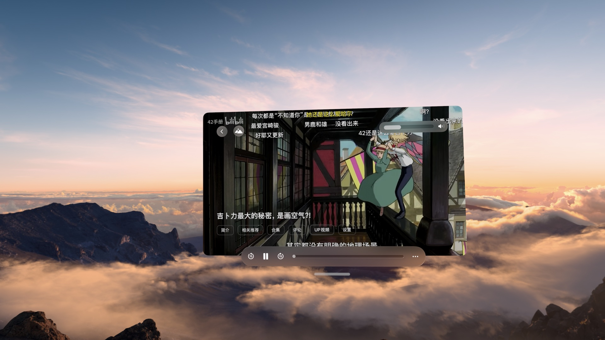
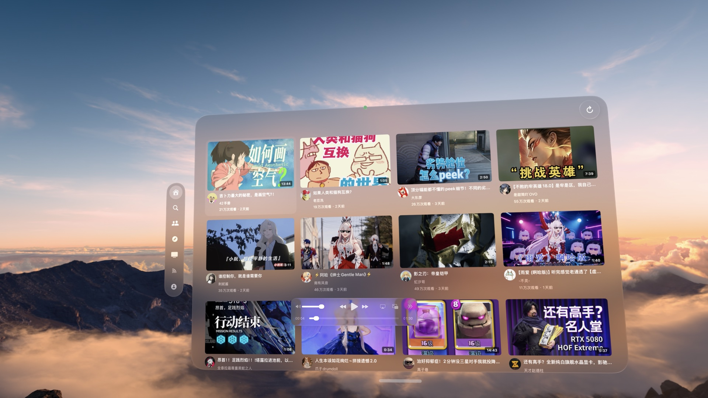
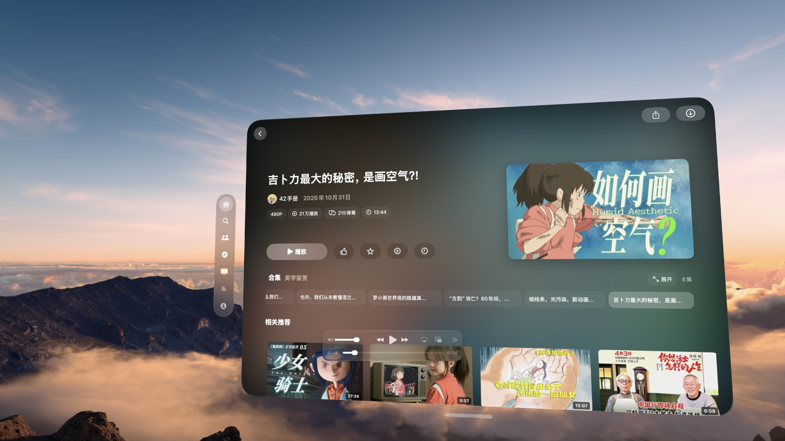
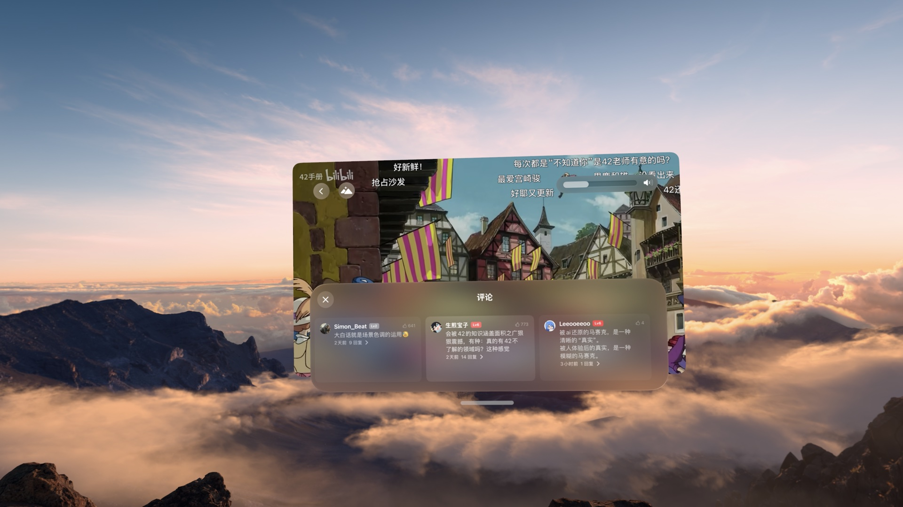
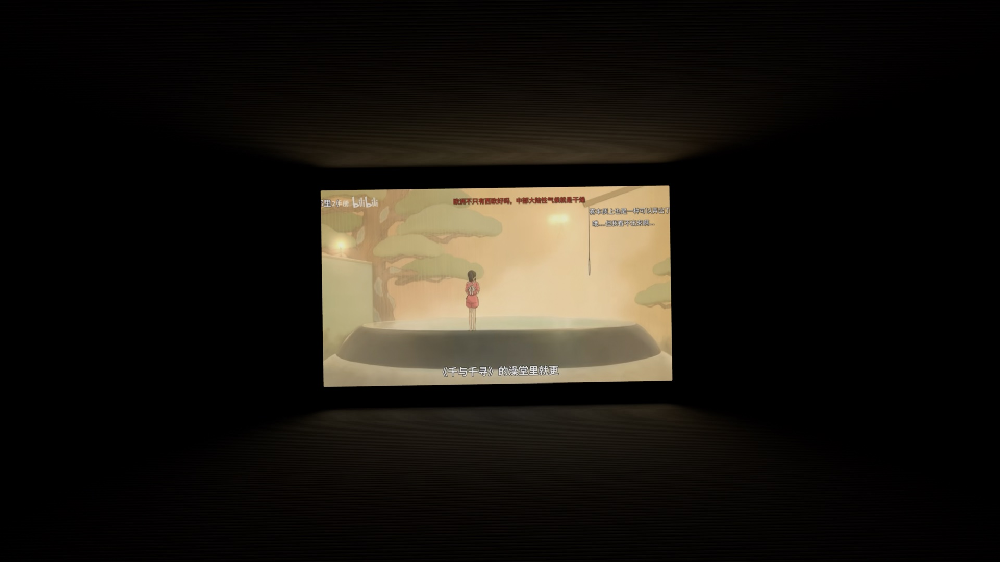
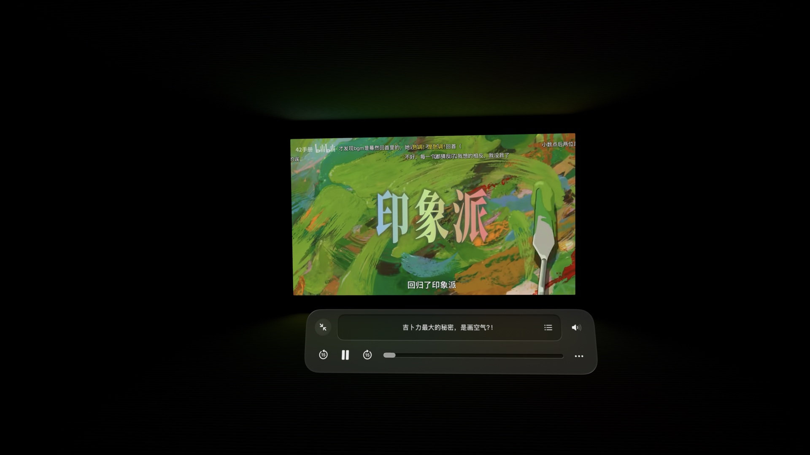

# LuuMo

**为 Apple Vision Pro 打造的空间媒体播放器。**

在空间中浏览内容、观看视频，将弹幕、评论和影院体验带到眼前。

## 功能介绍

- **发现内容**：浏览推荐、热门、关注、番剧和直播，搜索视频与用户。
- **空间播放**：支持窗口播放、经典沉浸影院与环境反光影院。
- **弹幕与互动**：观看弹幕，查看评论、相关推荐和 UP 主视频。
- **个人媒体库**：连接 SMB / NAS，浏览共享目录并播放视频。
- **播放体验**：支持字幕、章节、分集和播放进度记录，以及多种画质和音轨；高画质与音频格式取决于片源和账号权益。
- **手势操作**：通过手势调节播放进度、倍速或画面距离。

## 项目预览

### 发现喜欢的内容

### 视频详情

### 在空间中播放

### 评论与 UP 主视频

### 沉浸影院

## 反馈与支持

使用过程中遇到问题或有功能建议，欢迎在本仓库的 [Issues](../../issues) 中反馈，也可以访问 [技术支持页面](https://gist.github.com/lixiekun/eec0407ef85ff6238a10bc6d092698ee)。请勿在公开反馈中提交密码、Cookie 或其他敏感信息。

[隐私政策](https://gist.github.com/lixiekun/1971aae375105c95fded925a9e87a534)

---

本仓库用于介绍 LuuMo 和收集使用反馈。LuuMo 是独立开发的第三方客户端，并非哔哩哔哩官方产品。截图用于展示 App 使用体验。
